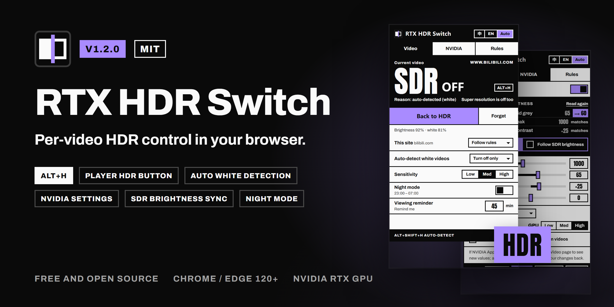

# RTX HDR Switch

English | [简体中文](README.zh-CN.md)

<p align="center"></p>

<p align="center"><br><sub>Tokyo photo in the demo by <a href="https://www.freepik.com/free-photo/aerial-view-tokyo-cityscape-with-fuji-mountain-japan_10824379.htm">tawatchai07 on Freepik</a></sub></p>

<p align="center"><b><a href="https://github.com/miniso7892-dotcom/rtx-hdr-switch/releases/latest">Download the latest release</a></b></p>

A Chrome / Edge extension (Manifest V3) that turns NVIDIA **RTX Video HDR** on or off **per video**. Keep HDR for videos where you want the extra brightness; switch white-background slides, screen recordings and long viewing sessions back to SDR. Comes with an HDR button and a settings panel inside the player, hold-to-compare, keyboard shortcuts, per-video memory, automatic detection of white-background videos, a night window and a continuous-viewing reminder. With the optional local helper you can also tune NVIDIA's RTX Video settings from the popup or the player, match them to your Windows SDR brightness in one click, bind NVIDIA presets to sites, undo changes, and turn off HDR only while keeping Super Resolution. Profiles switch a whole setup in one click. The interface is in English and Chinese, with a selectable theme color.

> **Switching HDR off for one video also switches off RTX Video Super Resolution (VSR) for that video** (a Chrome limitation). To keep VSR, turn on [Turn off HDR only, keep super resolution](#turn-off-hdr-only-keep-super-resolution) in the Rules tab (needs the local helper; it switches NVIDIA's global HDR).
>
> **The per-video switch can only turn RTX Video HDR *off*, it cannot turn it on.** RTX Video HDR must be enabled globally, in the NVIDIA App or, with the local helper installed, in the popup's NVIDIA tab (see [NVIDIA settings panel](#nvidia-settings-panel)).

## Features

- **Per-video toggle**: `Alt+H` switches RTX Video HDR for the video you are watching. Works in windowed and fullscreen playback and takes effect immediately, without reloading the page.
- **HDR button in the player's control bar** on Bilibili (videos and live), YouTube (watch page and embeds), Twitch, Tencent Video and iQIYI: one click does what `Alt+H` does, and the button shows whether HDR is on (see [Player button](#player-button)).
- **Settings panel in the player**: hover the HDR button to change this video, this site, white-video detection, NVIDIA settings, presets and profiles without leaving the video (see [Player panel](#player-panel)).
- **Hold to compare**: hold the HDR button to see the video the other way round; release to go back. Nothing is saved.
- **HDR only in fullscreen**, as the default or per site: windowed videos stay SDR, fullscreen gets HDR.
- **Keep for this tab**: after you switch two videos in a row the same way, one click keeps that choice for the next videos in the tab.
- **Remembers your choice** per video (up to 2000 videos; the oldest are pruned). Videos are recognized by ID on YouTube, Bilibili, Tencent Video, iQIYI and Twitch, and by a cleaned-up URL (tracking parameters removed) everywhere else.
- **Per-site rules**: always on / always off / fullscreen only / follow the other rules.
- **Automatic white-background detection** (`Alt+Shift+H` toggles it): samples the playing video every 1.5 s and turns HDR off after about 3 s of bright frames.
- **Night window** and a **continuous-viewing reminder** that can switch to SDR when the time is up.
- **Toolbar badge**: **HDR** in the theme color / black **SDR** / grey **DRM** for the main video of the current tab.
- **English / Chinese interface** (follows the browser by default) and **6 theme colors** plus a custom one; the toolbar icon follows the theme.
- **NVIDIA settings panel** (optional local helper): peak brightness, middle grey, contrast, saturation, Super Resolution, presets, day/night presets and **per-site presets**; **Windows SDR brightness sync**; middle grey shortcuts `Alt+Shift+↑/↓`; **turn off HDR only, keep VSR**.
- **NVIDIA change log with undo**: every change the extension makes to NVIDIA's settings is logged with its source; undo the last one from the popup or with a shortcut.
- **Profiles**: save a whole viewing setup (rules, optionally site rules and NVIDIA settings) under a name and switch in one click; undo a switch within 10 minutes.
- **Backup**: export and import settings, presets, profiles, site rules and remembered videos.
- **Diagnostics page**: helper status, raw NVIDIA state, frames, change log; copy a redacted report for bug reports.
- **Update check** for unpacked installs: a dot on the toolbar icon when a new release is out.
- **No data collection.** The only network request is the update check of unpacked installs, which can be turned off (see [Privacy](#privacy)).

## How it works

Chrome only sends a video through the NVIDIA video processor (which applies RTX Video HDR and VSR) when the video is promoted to a DirectComposition overlay. Any CSS `filter` on the `<video>` element makes Blink create a separate render surface, and a video inside a non-root render pass is not promoted to an overlay.

So to turn HDR off, the extension sets an inline `filter: brightness(0.9999) !important` on that `<video>` element (appended after the page's own inline filter, if it has one). The filter is invisible on 8-bit content and hardware decoding is not affected. To turn HDR back on, it restores the page's original inline `filter`.

Measured on Chrome 155 with NVIDIA driver 617.42, using an FP16 desktop capture: with RTX Video HDR active, white in the video reached about 1000 nits; with the filter applied, it dropped to the Windows SDR white level (set by the "SDR content brightness" slider). Removing the filter restored HDR immediately, in both windowed and `video.requestFullscreen()` playback.

The design notes and the Chromium source references are in [SPEC.md](SPEC.md) (Chinese).

## Requirements

- An NVIDIA RTX GPU with **RTX Video HDR enabled globally**: NVIDIA App → **System** → **Video** → **RTX Video Enhancement** → HDR (Super Resolution is optional), or the HDR switch in the popup's NVIDIA tab.
- Windows HDR turned on: Settings → System → Display → **Use HDR**.
- Hardware acceleration enabled in the browser (restart the browser after changing it):
  - Chrome: `chrome://settings/system` → **Use graphics acceleration when available**
  - Edge: `edge://settings/system` → **Use graphics acceleration when available**
- Chrome or Edge 120 or newer.

## Installation

The extension is not on the Chrome Web Store or Edge Add-ons yet, so you load it unpacked.

1. Get the code: `git clone` this repository, or click **Code → Download ZIP** on GitHub and extract it. Put it somewhere you won't move it.
2. Open the extensions page: `chrome://extensions` (Chrome) or `edge://extensions` (Edge).
3. Turn on **Developer mode** (top right in Chrome, left sidebar in Edge).
4. Click **Load unpacked** and select the `rtx-hdr-switch` folder, the one that directly contains `manifest.json`. (A ZIP download may extract to a nested folder of the same name.)
5. Pin the extension to the toolbar (puzzle-piece icon → pin) so you can see the badge.

Notes:

- **Don't move, rename or delete the folder after installing.** The browser loads the extension from it on every start. To move it, remove the extension first, move the folder, then load it again.
- Google Chrome stable ignores the `--load-extension` command-line flag, so the steps above are the only way to install it there.
- On install, update or reload, the extension injects itself into tabs that are already open. If a page doesn't respond (for example a tab that was asleep), reload that page.
- For local files (`file://`), turn on **Allow access to file URLs** on the extension's details page, then reload the page.
- Upgrading from 1.0: since 1.1 the `key` in `manifest.json` fixes the extension ID, so the browser treats it as a new extension and 1.0's settings don't carry over. From 1.2 on you can export and import a backup in the Rules tab.

### Updating

Extract the new release ZIP over the existing folder (replace the files), then click **Reload** on the extension's card at `chrome://extensions` (`edge://extensions` in Edge). Don't remove the extension and load it again: removing it deletes its settings. Export a backup first if you want to be safe. If the release notes say the local helper changed, run `native-host\install.cmd` again.

Unpacked installs check GitHub for new releases and show a dot on the toolbar icon (see [Update check](#update-check)).

## Check that it works

The badge only tells you whether the extension is blocking RTX Video HDR; it can't tell whether NVIDIA is actually processing the video. Check once like this:

1. Open NVIDIA App → **System** → **Video** and put it next to the browser. (NVIDIA App doesn't refresh this page by itself, see [Good to know](#good-to-know).)
2. Play an ordinary (not DRM-protected) video, e.g. on YouTube or Bilibili. Windowed playback is fine.
3. Under RTX Video Enhancement, the HDR **Status** should be active while the extension shows **HDR**.
4. Press `Alt+H` (or click **Switch to SDR** in the popup). Within a few seconds the status should go inactive and whites in the video should get visibly dimmer.
5. Press `Alt+H` again: the status goes back to active.

If the status is inactive from the start, RTX Video HDR itself isn't working and the extension isn't involved. Check the [requirements](#requirements), or try another video.

## Usage

### Badge

| Badge | Meaning |
|---|---|
| **HDR** in the theme color (lavender by default) | The extension is not blocking RTX Video HDR (whether it is actually active is shown in the NVIDIA App) |
| black **SDR** | The extension has turned RTX Video HDR off for this video |
| grey **DRM** | DRM-protected video; the extension can't control it |
| none | No video found on this tab |

### Keyboard shortcuts

| Shortcut | Action |
|---|---|
| `Alt+H` | Toggle RTX Video HDR for the current video (counts as a manual choice; remembered by default) |
| `Alt+Shift+H` | Turn white-background detection on/off |
| `Alt+Shift+↑` / `Alt+Shift+↓` | NVIDIA middle grey +5 / −5 (needs the [local helper](#install-the-local-helper)) |
| not set | Forget the current video's remembered choice (also ends *keep for this tab*) |
| not set | Switch to the next NVIDIA preset (needs the local helper) |
| not set | Compare HDR and SDR for 5 s; press again to end early |
| not set | Switch to the next profile |
| not set | Undo the last NVIDIA change (needs the local helper) |

Chrome allows at most four suggested keys per extension, so the commands added in 1.2 and 1.3 have no key until you set one. Shortcuts only work while a browser window has focus. Change them from the Rules tab (**Change**) or at `chrome://extensions/shortcuts` (`edge://extensions/shortcuts` in Edge). If another extension already uses a key, the browser may not assign it; set it there by hand.

When the state changes, a small label appears in the top-left corner of the video, e.g. *RTX HDR: on (manual)*, *RTX HDR: off (white video detected)* or *Middle grey 70 nits (+5)*.

### Player button

On these sites an **HDR** button sits among the player's own buttons on the right of its control bar:

- **Bilibili**: video, bangumi, list and festival pages, Bilibili players embedded in other sites, and **Bilibili Live** (live.bilibili.com)
- **YouTube**: the watch page, and **YouTube embeds** on other sites (youtube.com/embed and youtube-nocookie.com)
- **Twitch**, **Tencent Video** and **iQIYI**

| Button | Meaning |
|---|---|
| solid **HDR** badge | The extension is not blocking RTX Video HDR for this video |
| outlined badge with a slash | Switched to SDR |
| dimmed | DRM-protected video; the extension can't control it, and clicking does nothing |

- Clicking it does exactly what `Alt+H` does for that video (it counts as a manual choice and is remembered by default). With keyboard focus on it, a short press of Enter does the same.
- **Hold to compare**: hold the button (or Enter) for 0.3 s and the video switches to the other state while you hold it; a small *Comparing: SDR* label shows which. Releasing brings it back. Comparing doesn't change the remembered choice, the badge or the viewing timer. The *Compare HDR and SDR for a moment* shortcut does the same for 5 s.
- Space stays the player's play/pause key. Holding the button doesn't trigger the site's own long-press (YouTube's 2× speed).
- It uses the site's own button styles, so it looks like the other buttons and grows with them in fullscreen. Hover it to see the state in the interface language.
- With [Turn off HDR only](#turn-off-hdr-only-keep-super-resolution) on, it shows the video's chosen state, like the toolbar badge.
- It isn't shown in YouTube Shorts or on other sites (use `Alt+H` or the popup there), nor in Bilibili's small floating player. If a site redesigns its player, the button may be missing until the extension is updated; `Alt+H` and the popup keep working.
- To hide it, uncheck **Show an HDR button in player control bars** in the Rules tab. The change applies to open pages right away.

### Player panel

Rest the pointer on the HDR button for a moment and a settings panel opens above it, inside the player (below the button in YouTube embeds). It stays visible in fullscreen.

| Tab | What's in it |
|---|---|
| **This video** | The state and the reason; **HDR on / HDR off / Follow rules** for this video (*Follow rules* forgets the remembered choice); *Keep for the next videos in this tab*; **Hold to compare**; the rule for this site (follow / always on / always off / fullscreen); white-video detection and sensitivity |
| **NVIDIA** | Global RTX Video HDR switch, peak, middle grey, contrast, saturation, VSR, GPU priority, presets (click to apply), **Revert to when opened** (needs the local helper) |
| **Profiles** | Click a profile to switch; **Save current as profile…**; **Undo switch** |

- **Opening**: by default hovering for 0.35 s opens it and moving away closes it. In the Rules tab, **Player panel** switches between **Hover**, **Right-click** (right-click the button; the site's context menu doesn't appear) and **Off**. With keyboard focus on the button, Arrow Up or Shift+Enter opens it and moves focus into it.
- Once you use a control in it, it stays open until you press Esc, click outside it, or Tab out of it. Esc and Tab give focus back to the button.
- Clicking the HDR button still toggles the video while the panel is open; the panel updates right away.
- **All settings** opens the full popup for this tab.
- The panel is a page of the extension inside the player, so the website can't read it or click in it. It only accepts your own clicks and keys while it is visible, and closes itself if the page covers it or makes it transparent. It's opaque and uses no blur, transparency effects or animation over the video.

### Popup

Switch the language at the top right: 中 / EN / Auto (follows the browser). The popup has three tabs:

- **Video**: the current video's state (big HDR / SDR, the reason, the shortcut), **Switch to SDR / Back to HDR**, **Forget**, the last measured brightness, plus everyday settings: this site (follow rules / always HDR on / always HDR off / fullscreen only), white-video detection (turn off only / turn off and on / off) and sensitivity, night mode, and the viewing reminder in minutes (0 = off). If NVIDIA's global HDR is off, a notice with a **Turn on** button appears at the top. The footer links to the [diagnostics page](#diagnostics).
- **NVIDIA**: NVIDIA's global RTX Video settings, Windows SDR brightness sync, presets, and for 10 s after each change the [last change with an **Undo** button](#change-log-and-undo), see [NVIDIA settings panel](#nvidia-settings-panel).
- **Rules**: a notice when a new version is out (unpacked installs), [profiles](#profiles), theme color, HDR on / HDR off / fullscreen when no rule applies, whether web fullscreen counts as fullscreen, turn off HDR only, the night time range and day/night presets, the NVIDIA preset for this site, switch to SDR when the reminder is due, remember manual choices, on-screen labels, the player button and how the player panel opens, the update check, shortcuts, and backup export / import.

### Viewing

- **Hold to compare**: see [Player button](#player-button). In the panel, **Hold to compare** works while you hold it.
- **HDR only in fullscreen**: choose **Fullscreen** under *When no rule applies*, or **Fullscreen only** as a site rule. The video is SDR while windowed and HDR in fullscreen, including a player embedded in another page that the page puts in fullscreen. Web fullscreen on Bilibili and Bilibili Live counts as fullscreen while *Count web fullscreen as fullscreen* is checked. Picture-in-picture and the browser's own F11 fullscreen don't count.
- **Keep for this tab**: when you switch the next video the same way as the previous one, the label on the video offers *Keep for the next videos in this tab* for 4 s; click it, or check the same option in the panel. Autoplay, playlists and multi-part videos in that tab then follow your choice until you reload the page, forget the video, or uncheck it.

### Theme color

The Rules tab offers six presets (lime, yellow, signal orange, neon pink, electric cyan, lavender; lavender is the default) and a custom color picker. The popup, the divider in the toolbar icon, the HDR badge and the on-screen labels all follow it; text on the theme color switches between black and white automatically.

### Decision order

For each video, the first matching rule wins (the popup and the panel show which one as the reason):

| # | Reason | Comes from | Lasts |
|---|---|---|---|
| 1 | **Manual** | You toggled this video since the page was opened. The reminder's automatic switch to SDR also sits here | Remembered by default |
| 2 | **Kept for this tab** | [Keep for this tab](#viewing) | Until the page reloads |
| 3 | **Remembered for this video** | A choice you saved earlier | Up to 2000 videos |
| 4 | **Site rule** | *This site*: always on / always off / fullscreen only. For an embedded player, the site of the tab's top-level page counts | Settings |
| 5 | **Night mode** | Within the night window → off | Settings |
| 6 | **Auto-detected (white)** | The picture is judged white/bright → off | This page |
| 7 | **Default** / **Fullscreen only** | *When no rule applies*: HDR on / HDR off / fullscreen | Settings |

A site rule set to fullscreen only beats the night window, like the other site rules. The default set to fullscreen comes after night mode and white-video detection, so a white video stays SDR in fullscreen too.

On YouTube (mini player) and Twitch (mini player), a video that keeps playing after you navigate to the home page or a directory page keeps its identity, so its remembered and manual choices still apply.

### White-background detection

The main video is sampled as soon as it starts playing and then every 1.5 s, scaled down to 64×36 to measure average brightness and the share of white pixels. Three bright frames in a row (about 3 s) turn HDR off.

- **Turn off only**: once a video is judged bright, it stays off while the page is open, so mid-roll ads, quality changes and sensitivity changes don't flash it back to HDR.
- **Turn off and on**: six clearly dark frames in a row turn HDR back on; after any automatic switch the state is held for at least 10 s.
- All-black frames (transitions, loading) are ignored.
- Detection runs only when no manual, kept-for-tab, remembered, site or night rule applies, and pauses while the video is paused or the tab is hidden.

### Viewing reminder

- Counts time spent watching with HDR not blocked. **Changing video, autoplay and opening new tabs keep counting**; time paused, in the background or in SDR doesn't count.
- The count resets only after **more than 5 minutes without watching** (paused or page closed).
- When time is up, a message on the video suggests a break, and the count restarts.
- With *Switch to SDR when the viewing reminder is due* checked, the current video and every following video stay in SDR until you stop watching for over 5 minutes, switch HDR back on manually, or turn the option off.

### Backup

**Export backup** and **Import backup** at the bottom of the Rules tab open the extension's options page (a file picker would close the popup). A backup is one JSON file with settings, NVIDIA presets, profiles, site rules and remembered videos. Before importing, the page shows a summary (remembered videos, presets, site rules, profiles); confirming replaces the current settings and remembered videos, and the profiles if the backup has any. Version 1.2 can import a 1.3 backup but skips profiles, per-site presets and the fullscreen-only rules.

### Profiles

| | Contains | Used for |
|---|---|---|
| **Profile** | A whole viewing setup: default state, web fullscreen, remember manual choices, white-video detection and sensitivity, night mode, reminder, on-screen labels, player button and panel, turn off HDR only; optionally the site rules and the NVIDIA settings | Switch in one click; undo within 10 minutes |
| **NVIDIA preset** | NVIDIA settings only | Day/night and per-site switching, shortcut |
| **Backup** | Everything, including presets, profiles and remembered videos | Moving to another PC; importing replaces |

- **Save**: in the Rules tab, **Save current as profile…**, name it, and choose whether it includes site rules and NVIDIA settings. Saving under an existing name asks for a second click and replaces it.
- **Switch**: click it in the Rules tab, the player panel or the options page, or use the *Switch to the next profile* shortcut. The current profile is highlighted and marked *Modified* once your settings differ from it. **Undo switch** restores the previous settings within 10 minutes; NVIDIA values you changed since are left alone.
- **Share**: **Copy** puts a profile on the clipboard as text, **Paste to import** reads it back. The options page (*Profiles and backup*) also renames, exports to a file and imports from files; imported profiles with a taken name get a suffix like "(2)".
- Up to 20 profiles. Theme color, language and NVIDIA presets aren't part of a profile.

## NVIDIA settings panel

[简体中文说明](README.zh-CN.md#nvidia-参数面板)

The popup's NVIDIA tab reads and changes the same global settings that NVIDIA App shows under **System** → **Video** → **RTX Video Enhancement**, so changes apply to every video, in every browser and app, not only the current tab:

- **RTX Video HDR** on/off with NVIDIA's active/inactive status, **peak**, **middle grey**, **contrast** and **saturation**.
- **VSR** (Super Resolution): off / auto / manual quality (very low to high), **GPU priority** in auto mode, and the on-video NVIDIA status indicator.
- **Presets** (bottom of the tab): **Save as…** the current values, **Apply** them later, **Delete** them (deleting asks for a second click).
- **Day/night presets**: in the Rules tab, choose a preset for the night time range and one for the rest of the day. They follow the night window's times whether or not Night mode itself is on, and are applied once when the period starts; changes you make afterwards are kept until the next period.
- **Per-site presets**: in the Rules tab, *On this site use* binds a preset to the site of the current tab (the list below it shows the other bound sites, each with × to unbind). When a video plays on that site in the active tab, the preset is applied; when you leave the site (or 30 s after its video is gone), the values it changed are put back, except the ones you changed by hand in the meantime.
- **Shortcuts**: middle grey ±5 (`Alt+Shift+↑/↓`), *Switch to the next NVIDIA preset* and *Undo the last NVIDIA change* (no key assigned by default).
- The same controls are in the [player panel](#player-panel)'s NVIDIA tab. These are global settings: a change applies to every video, not just the one in the player.

### Who changes NVIDIA settings

| Source | When | Priority |
|---|---|---|
| You: popup, player panel, middle grey shortcuts, presets, undo | When you do it | 1 |
| Profile | When you switch | 1 |
| Per-site preset | A video plays on a bound site in the active tab | 2 |
| Day/night preset | A new period starts | 3 |
| Follow SDR brightness | The Windows SDR brightness changes (middle grey only) | event |
| Turn off HDR only | The video in front should be SDR (the HDR switch only) | temporary |

- A per-site preset that is active holds off the day/night presets until you leave the site.
- With *Follow SDR brightness* on, per-site and day/night presets leave middle grey alone; your own changes still apply until the SDR brightness changes again.
- While *Turn off HDR only* has switched global HDR off, saving a preset or profile stores HDR as it was before.

### Change log and undo

Every change the extension makes to NVIDIA's settings is logged with its source (popup, player panel, shortcut, schedule, SDR follow, profile, site preset, HDR only, undo); the last 100 entries are kept until the browser restarts and shown on the [diagnostics page](#diagnostics).

- For 10 s after a change, the NVIDIA tab shows *Last change: middle grey 65 → 70 (shortcut)* with **Undo**. The *Undo the last NVIDIA change* shortcut works any time within an hour; pressing it again undoes the change before.
- Undo only reverts values that are still what that change set. Values changed again since are left alone and named in the message.
- Switches made by *Turn off HDR only* aren't undoable; it gives the switch back by itself.

### Windows SDR brightness sync

The black block in the middle of the tab reads the current display's Windows "SDR content brightness" (in nits and as the slider position) and suggests three values; **Sync** writes the checked ones:

- **Middle grey** = SDR white × 0.2158 (the linear brightness of sRGB 50% grey), clamped to 10–100, so the mid-tones of RTX HDR video are as bright as 50% grey on the desktop.
- **Peak** = min(GPU maximum, 1000): with driver 617.42 the output stops getting brighter at about 1000 nits.
- **Contrast** +25: measured gamma ≈ 2.2, close to the curve Windows uses for SDR content.

Saturation is left alone. With **Follow SDR brightness** on, middle grey follows the formula whenever the Windows SDR brightness changes (checked every 2 s while the popup is open, every 30 s otherwise); while the SDR brightness stays the same, a middle grey you set by hand is kept. With several displays you can choose which one to use.

### Turn off HDR only, keep super resolution

With this on (Rules tab), videos that should be SDR no longer get the filter (they stay on the overlay, so VSR keeps working). Instead the extension uses the local helper to switch NVIDIA's **global** RTX Video HDR off for a while:

- Global HDR goes off while the main video of the active tab in the focused window should be SDR, and comes back when it should be HDR, when you switch tabs, or when the video is gone.
- In testing the switch took effect within 0.1–0.3 s, VSR stayed on, and white dropped exactly to the Windows SDR white.
- Because it is the global switch, other videos playing at the same time (in another window or another app) turn SDR too.
- Only the video in front is switched this way. A video in another browser window that should be SDR still gets the per-video filter, so it stays SDR while global HDR is on (and its VSR is off).
- If the browser quits, crashes or the extension reloads, the local helper switches global HDR back on by itself.
- If you switch global HDR yourself in the popup meanwhile, your choice wins and that video no longer borrows the switch.
- Without the local helper (or with a 1.1 helper) the mode doesn't apply and the extension falls back to the per-video filter; the Rules tab says why.

### Install the local helper

A browser extension can't call NVIDIA's settings interface directly, so these features talk to a small helper program (a native messaging host) in the `native-host` folder. Without it the NVIDIA tab says the local helper isn't installed and the rest of the extension works as before.

1. Install the extension: load this folder as it is (see [Installation](#installation)), or install it from the Chrome Web Store. The helper accepts these two extension IDs: `omgekmljdifpghaimigdbbbcmnjddmdd` for the loaded folder (fixed by the `key` in `manifest.json`) and `ngpglblkbhffcikcbkodlmgbaaojgmpp` for the Chrome Web Store version. A copy without the `key` or a repacked build gets a different ID, and the helper rejects it.
2. Double-click `native-host\install.cmd`. It builds `rtx_hdr_host.exe` with the C# compiler that comes with Windows (.NET Framework 4.x) and registers it for Chrome, Edge and Chromium for the current user (`HKCU`). No admin rights are needed. The Chrome Web Store version doesn't include the helper: download the ZIP from the [latest release](https://github.com/miniso7892-dotcom/rtx-hdr-switch/releases/latest), extract it to a folder you'll keep, and run `native-host\install.cmd` from there.
3. Close and reopen the popup. The NVIDIA tab should now show the current values.

Requirements: Windows 10/11 (x64) and NVIDIA App, whose `nvcpl.dll` the helper uses. Keep the folder on a path without `&`, `^` or `%`: the browser starts the helper through `cmd.exe`, which breaks on these characters. After updating from 1.1 to 1.2, run `install.cmd` again: SDR sync and *Turn off HDR only* need the 1.2 helper. The Chrome Web Store version needs the 1.2.1 helper or newer. The protocol is documented in [native-host/README.md](native-host/README.md).

To uninstall, double-click `native-host\uninstall.cmd` (it removes the registry entries), then delete the folder. If you move the folder, run `install.cmd` again.

### Good to know

- **NVIDIA App shows the old values until you leave its Video page and open it again.** While that page shows old values, don't move its sliders: NVIDIA App writes back everything it has on screen and undoes the popup's changes.
- The helper uses NVIDIA App's own `nvcpl.dll` through an undocumented interface. It was tested with NVIDIA App 11.0.9 and driver 617.42; a later NVIDIA App update may break it. The popup then shows an error and the rest of the extension keeps working.
- Peak above about 1000 nits made no difference in testing: driver 617.42 capped the output at about 1000 nits. The popup shows a hint when you go above 1000.
- The helper runs while the popup is open, while the player panel is open and for 20 s after it closes, for 15 s after a preset, shortcut, profile, site preset or SDR follow-up, and continuously while *Turn off HDR only* is borrowing the switch. It runs locally and makes no network connections. Reading the SDR brightness only reads Windows' display settings; it never changes them.
- The popup and the player panel each talk to their own helper process. Moving a slider in both at the same instant can lose one of the two changes.

## Diagnostics

**Diagnostics** in the popup's footer (or at the top right of the options page) opens a page with the local helper's status and what to do about it, the raw NVIDIA state, displays, the *Turn off HDR only* lease, the reports of every frame in the current tab, the NVIDIA change log, alarms, storage use, the update check and the settings.

**Copy diagnostics** copies all of it as JSON for a bug report. Site names, URLs, video IDs, display names and your Windows user name are replaced by numbers like `host#1` unless you check **Include URLs and device names**.

## Update check

Installs from the Chrome Web Store update by themselves. Unpacked installs (loaded from a folder) ask GitHub for the latest release: after a successful check the next one waits 24 hours, a failed check is retried later, and **Check now** on the diagnostics page checks right away. When a newer version is out, the toolbar icon gets a small dot and the Rules tab shows a card with **Export a backup first**, **Download zip**, **Release page** and **Skip this version**; × hides it for 7 days. Uncheck **Check for updates** in the Rules tab to turn it off. See [Updating](#updating) for how to install the new version.

## Limitations

- **The per-video switch can only turn RTX Video HDR off.** If RTX Video HDR is not enabled globally, or hardware acceleration is off, there is no HDR to switch, even when the badge says **HDR**.
- **Switching HDR off per video also switches off VSR** for that video (Chrome limitation). *Turn off HDR only* uses the global switch instead, so other videos playing at the same time turn SDR too.
- **DRM-protected videos can't be controlled.** They are presented through a Media Foundation overlay that CSS doesn't affect, and their frames can't be read for detection. The badge shows **DRM**. They still count towards the viewing reminder.
- **Picture-in-Picture**: the browser sends the video straight to the PiP window, so HDR can't be turned off there. It works again once the video is back in the page.
- **Cross-origin videos without CORS** can't be sampled, so auto-detection doesn't work for them. Manual toggling, memory and site rules still work.
- Some pages keep rewriting the video's style. The extension backs off, shows *the page keeps rewriting the video style* as the reason, and retries later, or immediately when you toggle manually.
- If a page already puts a `filter` on the video (e.g. a player's picture-adjustment feature), the video isn't on an overlay to begin with, so RTX Video HDR isn't active anyway.
- In element fullscreen (`video.requestFullscreen()`), the on-screen label is hidden behind the browser's fullscreen layer. Site players' own fullscreen modes are fine.
- Browser-internal pages (`chrome://`, the extension stores) are not supported.
- **Hold to compare** can't compare while *Turn off HDR only* has global HDR off: there is no HDR to compare with. Comparing from HDR to SDR uses the per-video filter, so VSR is off while you hold.
- **HDR only in fullscreen** follows fullscreen one level deep: a page that puts an embedded player into fullscreen is detected, a player nested two iframes deep isn't. With *Turn off HDR only* on, entering and leaving fullscreen switches global HDR each time.
- A remembered choice beats *fullscreen only*: after you toggle a video by hand it keeps that state in and out of fullscreen. Use **Follow rules** in the panel or **Forget** in the popup to hand it back.
- **Keep for this tab** lasts until the page reloads or navigates to a new page.
- The player panel only appears where the HDR button does. In a YouTube embed on another site, the panel accepts changes only while the browser confirms it is fully visible.
- The player panel's NVIDIA tab changes global settings: other videos and apps see the change too.

## Troubleshooting

| Symptom | Fix |
|---|---|
| Popup says *Not connected to this page yet* | Reload the page. Tabs that were open or asleep before install may not have been injected. |
| Popup says no video / no video showing / out of view | Make sure the video is on the page (some sites create it only after you press play) and scrolled into view. |
| **HDR** badge but the picture isn't bright / NVIDIA App shows inactive | RTX Video HDR itself isn't working. Check the [requirements](#requirements). |
| Brightness doesn't change after switching to SDR | First confirm RTX Video HDR works (see [Check that it works](#check-that-it-works)). DRM and PiP videos can't be controlled. |
| Shortcut does nothing | Check that a key is assigned on the shortcuts page and doesn't clash with another extension, and that the browser window has focus. |
| A white-background video isn't switched off | Make sure detection isn't set to *Off* and no higher-priority rule applies; try a higher sensitivity. Cross-origin videos can't be detected. |
| Extension stops working / "could not load" | Check that the `rtx-hdr-switch` folder hasn't been moved or deleted. |
| NVIDIA tab says the local helper isn't installed | Run `native-host\install.cmd` (see [Install the local helper](#install-the-local-helper)), then reopen the popup. Run it again after moving the folder. |
| NVIDIA tab or the diagnostics page says the local helper is out of date, or *Turn off HDR only* doesn't apply | Run `native-host\install.cmd` again from the current folder to update the helper. |
| Diagnostics says the helper can't be reached after you moved or replaced the folder | Run `native-host\install.cmd` again in the folder the extension is loaded from. |
| NVIDIA tab says the local helper doesn't accept this extension's ID | Chrome Web Store version: the installed helper is older than 1.2.1. Run `native-host\install.cmd` from the [latest release](https://github.com/miniso7892-dotcom/rtx-hdr-switch/releases/latest). Loaded folder: load this folder unpacked as it is, without removing the `key`; running `install.cmd` again doesn't help. |
| NVIDIA tab says NVIDIA App (nvcpl.dll) wasn't found | Install NVIDIA App. |
| NVIDIA App still shows the old values | Leave NVIDIA App's Video page and open it again (see [Good to know](#good-to-know)). |
| The player panel doesn't open | Check that **Player panel** in the Rules tab isn't *Off* and the player is at least 260 × 160 px. On *Right-click*, right-click the HDR button. |
| A video stays SDR when windowed | Check whether *When no rule applies* or the site rule is set to fullscreen. |
| A change to NVIDIA settings wasn't yours | Open the diagnostics page: the change log shows each change and where it came from. |
| Reporting a bug | Attach the output of **Copy diagnostics** (redacted by default). |

## Development

No build step and no dependencies. The tests use only Node's built-in `node:assert`.

```sh
node test/lib.test.js        # unit and structure tests: decisions, video keys, auto-detection, filter, viewing timer, settings and patches, i18n, theme, SDR suggestions, backup, profiles, site presets, change log and undo, update check, redaction, panel handshake, manifest
python tools/make_icons.py   # regenerate icons/ (needs Pillow; --accent "#RRGGBB" for another color)
native-host\build.cmd                      # build rtx_hdr_host.exe (in-box C# 5 compiler)
node native-host/test/host.test.mjs        # local helper tests (read-only)
node native-host/test/host.test.mjs --live # plus reversible writes (middle grey +1, the HDR lease), then restored
```

| File | Purpose |
|---|---|
| `manifest.json`, `_locales/` | MV3 manifest; English / Chinese name, description and shortcut names |
| `background.js` | Service worker: badge, shortcuts, viewing timer, injection on install, the only writer of settings and profiles, NVIDIA writes with the change log and undo, day/night and per-site presets, SDR follow-up, the HDR lease, profiles, update check, diagnostics snapshot, player panel registration |
| `i18n.js` | Interface strings (Chinese / English) |
| `lib.js` | Pure logic shared by the content script, pages, service worker and tests |
| `content.js` | Content script: finds videos, applies the filter, samples frames, on-screen labels, the player button, hold to compare, fullscreen detection, the player panel frame |
| `popup.*` | Popup |
| `panel.*` | Player panel (an extension page in an iframe inside the player) |
| `nv-client.js`, `ui-kit.js`, `ui-base.css` | Shared by the popup and the panel: helper connection, UI helpers, base styles |
| `options.*` | Options page (profiles and backup) |
| `diag.*` | Diagnostics page |
| `icon-draw.js`, `icons/`, `tools/make_icons.py` | Icon: redrawn in the theme color at runtime / static PNGs / generator |
| `fonts/` | Anton and Archivo (OFL, Latin subset) |
| `native-host/` | Local helper: `RtxHdrHost.cs`, build / install / uninstall scripts, host manifest, tests, protocol |
| `SPEC.md` | Design spec and measurements (Chinese) |

### Permissions

| Permission | Why |
|---|---|
| `storage` | Settings, profiles, remembered videos, per-tab state and the change log |
| `scripting` | Inject the content script into tabs that were already open when the extension was installed or updated |
| `nativeMessaging` | Talk to the optional local helper that reads and writes NVIDIA's RTX Video settings |
| `alarms` | Check whether a day/night preset is due (once a minute), follow the SDR brightness (every 30 s), recheck a per-site preset after its video is gone, and the update check of unpacked installs; each only while it is turned on |
| `<all_urls>` | Videos can be on any site, including embedded players in iframes; the open tabs' URLs for the badge, per-site presets and injection on install |

1.3 removed the `tabs` permission. `panel.html` is the only web-accessible resource: it is exposed only to the player sites that get the HDR button (Bilibili, Bilibili Live, YouTube and its embeds, Twitch, Tencent Video, iQIYI) and only with dynamic URLs, which change every browser session, so other sites can't load it or use it to detect the extension.

## Privacy

The extension collects no data. Settings, profiles and remembered videos are stored locally in `chrome.storage.local`; per-tab state, the viewing timer and the NVIDIA change log live in `chrome.storage.session` and are cleared when the browser restarts. Auto-detection scales the video frame down to 64×36 in memory to measure brightness; frames are never stored or sent anywhere. Backup, profile and diagnostics files are saved only where you choose. The optional local helper runs only on your PC, talks only to the extension, NVIDIA App's `nvcpl.dll` and Windows' display configuration API, and makes no network connections.

The only network request is the update check, and only for unpacked installs (the Chrome Web Store version never makes it): a `GET` to `api.github.com` for the latest release of this repository, without cookies or referrer; after a successful check the next one waits 24 hours, a failed check is retried later, and **Check now** on the diagnostics page sends one right away. It sends no settings, browsing history or identifiers; like any request, GitHub sees your IP address and browser user agent. Uncheck **Check for updates** in the Rules tab to turn it off.

## License

[MIT](LICENSE). The Anton and Archivo fonts in `fonts/` are under the SIL Open Font License (see `fonts/OFL-*.txt`).

## Disclaimer

This is an independent open-source project. It is not affiliated with, endorsed by or sponsored by NVIDIA Corporation. NVIDIA, RTX and GeForce are trademarks of NVIDIA Corporation. Chrome is a trademark of Google LLC; Microsoft Edge is a trademark of Microsoft Corporation. These names are used only to describe compatibility.
