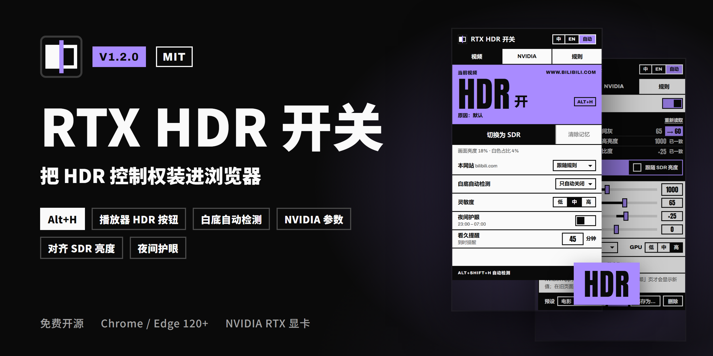

# RTX HDR 开关（Chrome / Edge 扩展）

[English](README.md) | 简体中文

<p align="center"></p>

<p align="center"><br><sub>演示中的东京照片来自 <a href="https://www.freepik.com/free-photo/aerial-view-tokyo-cityscape-with-fuji-mountain-japan_10824379.htm">Freepik 上的 tawatchai07</a></sub></p>

<p align="center"><b><a href="https://github.com/miniso7892-dotcom/rtx-hdr-switch/releases/latest">下载最新版本</a></b></p>

按视频控制 NVIDIA「RTX 视频增强」的 HDR（RTX Video HDR / TrueHDR）：想要高亮度的视频保持 HDR，白底、纯白、长时间观看的视频切回 SDR。支持快捷键；B 站（含直播）、YouTube（含嵌入播放器）、Twitch、腾讯视频、爱奇艺播放器控制栏里的 HDR 按钮，悬停打开播放器内的设置面板，按住对比 HDR 和 SDR；记住每个视频的选择、只在全屏时开启 HDR、本标签页后续视频沿用、自动识别白底视频、夜间护眼和连续观看提醒；配置档一键切换整套设置。装上可选的本地组件后，还能在弹窗或播放器里直接调 NVIDIA 的 RTX 视频参数、按 Windows 的 SDR 亮度一键对齐、按网站切换 NVIDIA 预设、撤销修改、只关 HDR 保留超分。另有诊断页，解压安装时会检查新版本。界面有中文和英文，主题色可以换。

> **按视频切换时，该视频的 RTX 超分（VSR）会和 HDR 一起关闭**（Chrome 的限制）。想保留超分，可以在「规则」里打开 [只关 HDR，保留超分](#只关-hdr保留超分)（需要本地组件；关闭的是 NVIDIA 全局 HDR）。
>
> **按视频切换只能「关掉」RTX HDR，不能「打开」它。** RTX HDR 本身要全局开启：在 NVIDIA App 里，或者装好本地组件后在弹窗的「NVIDIA」页签里（见 [NVIDIA 参数面板](#nvidia-参数面板)）。

## 原理

Chrome 只有在视频被提升为 DirectComposition overlay 时才会调用 NVIDIA 视频处理器。扩展在需要关闭的 `<video>` 元素上加一条内联样式 `filter: brightness(0.9999) !important`（页面自己给视频加了 filter 时，叠加在它后面），视频就不再走 overlay，RTX HDR 和超分随之关闭；开启时把页面原来的内联 `filter` 还原。8 bit 画面上看不出这个滤镜的差别，切换实时生效，不需要刷新页面，窗口和全屏都有效。硬件解码不受影响。

实测（Chrome 155 + NVIDIA 驱动 617.42，FP16 桌面抓取）：RTX HDR 生效时画面白色约 1000 尼特；加上滤镜后降到 Windows 的 SDR 白（由「SDR 内容亮度」决定），去掉滤镜立即恢复。设计细节和源码依据见 [SPEC.md](SPEC.md)。

## 使用前提

- NVIDIA App 里打开了「RTX 视频增强」的 HDR：NVIDIA App → **系统** → **视频** → **RTX 视频增强**（超分按需打开）；装了本地组件的话也可以在弹窗的 [NVIDIA 参数面板](#nvidia-参数面板) 里打开。
- Windows 的 HDR 已开启（设置 → 系统 → 屏幕 → 使用 HDR）。
- 浏览器开启了硬件加速：
  - Chrome：`chrome://settings/system` → 「使用图形加速功能（如果可用）」
  - Edge：`edge://settings/system` → 「在可用时使用图形加速」

  改完需要重启浏览器。
- Chrome / Edge 120 或更新版本。

## 安装

0. 获取代码：`git clone` 本仓库，或在 GitHub 页面点 **Code → Download ZIP** 下载后解压，放到一个长期不动的位置。
1. 打开扩展管理页：
   - Chrome：地址栏输入 `chrome://extensions`
   - Edge：地址栏输入 `edge://extensions`
2. 打开开发模式：
   - Chrome：右上角的 **开发者模式**
   - Edge：左侧栏的 **开发人员模式**
3. 加载扩展：
   - Chrome：点击 **加载已解压的扩展程序**
   - Edge：点击 **加载解压缩的扩展**

   然后选择 `rtx-hdr-switch` 文件夹（里面直接就有 `manifest.json` 的那一层；ZIP 解压后可能多套了一层同名文件夹）。
4. 建议把扩展固定到工具栏（点工具栏上的拼图图标 → 图钉），方便看角标。

说明：

- **安装后不要移动、重命名或删除这个文件夹。** 浏览器每次启动都从这里读取扩展，文件夹不在了扩展就会失效。要换位置的话，先在扩展管理页「移除」，挪好文件夹后再重新加载。
- Google Chrome 稳定版会忽略 `--load-extension` 命令行参数，只能用上面的方法安装。
- 安装（或更新、重新加载）扩展时，已经打开的 http/https 页面会被自动注入脚本，一般不用刷新。如果某个页面没有反应，**刷新一下该页面**即可。
- 本地文件（`file://`）需要在扩展详情页打开「允许访问文件网址」后再刷新页面。
- 从 1.0 升级：1.1 起 `manifest.json` 里有固定扩展 ID 的 `key`，浏览器会把它当成一个新扩展，1.0 的设置和记住的视频不会带过来，需要重新设置。1.2 起可以在「规则」页签底部导出 / 导入备份。

### 更新

把新版本的 ZIP 解压覆盖到原来的文件夹（替换文件），再在 `chrome://extensions`（Edge 为 `edge://extensions`）里点这个扩展的 **重新加载**。不要移除扩展再重新加载：移除会删掉它的设置。稳妥起见可以先导出备份。发布说明里写了本地组件有更新时，再运行一次 `native-host\install.cmd`。

以解压方式安装时，扩展会向 GitHub 查询新版本，有新版本时工具栏图标上会出现一个小点（见 [检查新版本](#检查新版本)）。

## 验证是否生效

角标只说明扩展有没有挡住 RTX HDR，不能证明 NVIDIA 真的在处理视频。第一次用时建议这样确认一次：

1. 打开 NVIDIA App → **系统** → **视频**，把窗口放在浏览器旁边。（NVIDIA App 不会自己刷新这一页，见 [注意事项](#注意事项)。）
2. 在浏览器里播放一个普通（非会员、非付费）的视频，例如 YouTube 或 B 站的视频，保持窗口化播放即可。
3. 看 NVIDIA App 里「RTX 视频增强」下 HDR 一项的 **状态**：扩展显示 HDR 开时应为激活状态（不同版本的字样可能是「已激活」或「活动」）。
4. 按 `Alt+H`（或在弹窗里点「切换为 SDR」）：几秒内状态应变为未激活，画面里的白色也会明显变暗（从 RTX HDR 的高亮度降到 Windows SDR 白的亮度）。
5. 再按一次 `Alt+H`，状态回到已激活，白色重新变亮。

如果第 3 步一开始就是未激活，说明 RTX HDR 本身没有生效，和扩展无关：检查上面的「使用前提」，或者换一个视频试试（受版权保护的视频本来就不走这条路径）。

## 使用

### 角标

工具栏图标上的角标显示当前标签页主视频的状态：

- 主题色 **HDR**（默认薰衣紫）：扩展没有阻止 RTX HDR（实际是否生效以 NVIDIA App 里的状态为准，见上面的「验证是否生效」）
- 黑底 **SDR**：扩展已为这个视频关闭 RTX HDR
- 灰底 **DRM**：受版权保护的视频，扩展无法控制（多见于会员影视）
- 无角标：没有检测到视频

### 快捷键

| 快捷键 | 作用 |
|---|---|
| `Alt+H` | 切换当前视频的 RTX HDR（记为「手动」，默认会记住） |
| `Alt+Shift+H` | 开启或关闭白底视频自动检测 |
| `Alt+Shift+↑` / `Alt+Shift+↓` | NVIDIA 中间灰 +5 / −5（需要[本地组件](#安装本地组件)） |
| 未设置 | 清除当前视频的记忆（恢复按规则决定，同时取消本标签页沿用） |
| 未设置 | 切换到下一个 NVIDIA 预设（需要本地组件） |
| 未设置 | 临时对比 HDR 和 SDR 5 秒，再按一次提前结束 |
| 未设置 | 切换到下一个配置档 |
| 未设置 | 撤销上一次 NVIDIA 修改（需要本地组件） |

Chrome 每个扩展最多 4 个建议快捷键，1.2 和 1.3 新增的命令默认没有按键，需要自己设置。快捷键只在浏览器窗口有焦点时生效。可以在弹窗「规则」页签里点「修改」，或打开 `chrome://extensions/shortcuts`（Edge 为 `edge://extensions/shortcuts`）修改；如果和其他扩展冲突，浏览器可能不会分配建议的按键，需要在这里手动设置。

切换时视频左上角会显示一个小提示，例如「RTX HDR：开（手动）」「RTX HDR：关（检测到白底）」「中间灰 70 尼特（+5）」。

### 播放器控制栏按钮

在下面这些网站，播放器控制栏右侧原生按钮之间会多一个 **HDR** 按钮：

- **B 站**：视频、番剧、播放列表、活动页，嵌在其他网站里的 B 站播放器，以及 **B 站直播**（live.bilibili.com）
- **YouTube**：视频播放页，以及嵌在其他网站里的 **YouTube 播放器**（youtube.com/embed 和 youtube-nocookie.com）
- **Twitch**、**腾讯视频**、**爱奇艺**

| 按钮 | 含义 |
|---|---|
| 实心 **HDR** 徽标 | 扩展没有阻止这个视频的 RTX HDR |
| 描边徽标加斜杠 | 已切回 SDR |
| 变暗 | 受版权保护的视频，扩展无法控制，点了没有反应 |

- 点击它，和对这个视频按 `Alt+H` 完全一样（记为「手动」，默认会记住）。键盘焦点在它上面时短按回车也一样。
- **按住对比**：按住按钮（或回车）0.3 秒，视频在按住期间切到相反的状态，左上角的小提示「对比：SDR」说明现在是哪种；松开就回来。对比不改记忆、角标和护眼计时。快捷键「临时对比 HDR 和 SDR」效果相同，持续 5 秒。
- 空格仍然是播放器的播放 / 暂停。按住按钮不会触发网站自己的长按（YouTube 的 2 倍速）。
- 用的是网站自己的按钮样式，大小、悬停效果和其他按钮一致，全屏时跟着一起变大。鼠标悬停会显示当前状态（跟随界面语言）。
- 打开 [只关 HDR，保留超分](#只关-hdr保留超分) 时，按钮显示的是这个视频该开启还是该关闭，和角标一致。
- YouTube Shorts 和其他网站没有这个按钮（用 `Alt+H` 或弹窗）；B 站的小窗播放器里也不显示。网站改版播放器后按钮可能暂时不出现，`Alt+H` 和弹窗照常可用。
- 不想要的话，在「规则」页签取消勾选「在播放器控制栏显示 HDR 按钮」，已打开的页面立即生效。

### 播放器面板

鼠标在 HDR 按钮上停一下，按钮上方会在播放器里打开设置面板（YouTube 嵌入播放器里在按钮下方），全屏时照样显示。

| 页签 | 内容 |
|---|---|
| **本视频** | 状态和原因；这个视频「开启 HDR / 关闭 HDR / 跟随规则」（「跟随规则」会清除这个视频的记忆）；「本标签页后续视频沿用」；「按住对比」；本网站的规则（跟随规则 / 总是开启 / 总是关闭 / 仅全屏）；白底检测和灵敏度 |
| **NVIDIA** | 全局 RTX 视频 HDR 开关、最高亮度、中间灰、对比度、饱和度、超分、GPU 优先级、预设（点一下套用）、「还原到打开时」（需要本地组件） |
| **配置档** | 点一下切换配置档；「保存当前为配置档…」；「撤销切换」 |

- **打开方式**：默认悬停 0.35 秒打开、移开就收起。在「规则」页签的「面板打开方式」里可以改成「右键」（在按钮上点右键，网站的右键菜单不会出现）或「关闭」。键盘焦点在按钮上时，按向上方向键或 Shift+回车打开，焦点移进面板。
- 在面板里操作过以后，它会一直开着，直到按 Esc、点击面板外面或用 Tab 移出。按 Esc 和 Tab 收起时焦点回到按钮。
- 面板开着时点 HDR 按钮照样切换当前视频，面板里的状态立即更新。
- 「完整设置」打开这个标签页的完整弹窗。
- 面板是扩展自己的页面，嵌在播放器里，网站读不到它，也点不了它。它只接受你在面板显示时的真实点击和按键；网页把它盖住或改成透明时会自动收起。面板不透明，盖在视频上的部分不用模糊、透明效果和动画。

### 弹窗

右上角切换界面语言：中 / EN / 自动（跟随浏览器）。下面分三个页签：

- **视频**：当前视频的状态（HDR / SDR 大字、原因、快捷键）、「切换为 SDR / 切回 HDR」、「清除记忆」，自动检测最近测到的画面亮度；以及常用设置：本网站（跟随规则 / 总是开启 HDR / 总是关闭 HDR / 仅全屏）、白底自动检测（只自动关闭 / 自动开关 / 关闭）和灵敏度、夜间护眼开关、看久提醒的分钟数（0 = 关闭）。NVIDIA 全局 HDR 关着时，顶部会提示并给一个「开启」按钮。底栏有 [诊断](#诊断) 入口。
- **NVIDIA**：NVIDIA 的全局 RTX 视频设置、Windows SDR 亮度同步、预设，每次修改后 10 秒内显示 [上一次修改和「撤销」](#修改记录与撤销)，见 [NVIDIA 参数面板](#nvidia-参数面板)。
- **规则**：有新版本时的提醒卡（解压安装）、[配置档](#配置档)、主题色、没有规则时开启 HDR / 关闭 HDR / 仅全屏、网页全屏也算全屏、只关 HDR 保留超分、夜间时段和时段预设、本网站套用的 NVIDIA 预设、看久提醒到时自动切回 SDR、手动切换后记住此视频、切换时显示屏幕提示、在播放器控制栏显示 HDR 按钮和面板打开方式、检查新版本、快捷键列表，以及导出 / 导入备份。

### 看片功能

- **按住对比**：见 [播放器控制栏按钮](#播放器控制栏按钮)。面板里的「按住对比」按住期间生效。
- **只在全屏时开启 HDR**：在「没有规则时」选「仅全屏」，或者把某个网站的规则设为「仅全屏」。窗口播放时是 SDR，全屏时是 HDR；网页把嵌入的播放器整个设为全屏时也算。勾选「网页全屏也算全屏」时，B 站的网页全屏也算全屏。画中画和浏览器自己的 F11 全屏不算。
- **本标签页后续视频沿用**：下一个视频你又做了和上一个视频一样的切换时，视频上的提示会变成可点的「本标签页后续视频沿用」，显示 4 秒；点一下，或者在面板里勾选同名选项，这个标签页里之后自动连播、播放列表、分 P 的视频都按这个选择，直到刷新页面、清除记忆或取消勾选。

### 主题色

「规则」页签的「主题色」里有 6 个预设（荧光绿、明黄、信号橙、霓虹粉、电光青、薰衣紫，默认薰衣紫），也可以用「自定义颜色」选任意颜色。弹窗、工具栏图标中间那道分割线、HDR 角标和屏幕提示都会跟着变；主题色上的文字按颜色深浅自动用黑字或白字。

### 决策顺序

每个视频按下面的顺序取第一个命中的规则（弹窗和面板里的「原因」就是命中的那一条）：

| # | 原因 | 来源 | 保留多久 |
|---|---|---|---|
| 1 | **手动** | 本次打开页面后对这个视频手动切换过（「护眼提醒」自动切回 SDR 也属于这一级） | 默认会记住 |
| 2 | **本标签页沿用** | [本标签页后续视频沿用](#看片功能) | 刷新页面前 |
| 3 | **已记住此视频** | 之前手动切换并记住的选择 | 最多 2000 个视频 |
| 4 | **网站规则** | 「本网站」：总是开启 / 总是关闭 / 仅全屏（视频在别的网站的嵌入播放器里时，以当前标签页这个网站的设置为准） | 设置 |
| 5 | **夜间护眼** | 处于夜间时段时关闭 | 设置 |
| 6 | **自动检测(白底)** | 画面判定为白底/高亮时关闭 | 本次打开页面 |
| 7 | **默认** / **仅全屏** | 「没有规则时」：开启 HDR / 关闭 HDR / 仅全屏 | 设置 |

网站规则设为「仅全屏」时和其他网站规则一样优先于夜间护眼；「没有规则时」设为「仅全屏」则排在夜间护眼和白底检测之后，白底视频全屏时也保持 SDR。

视频按网站识别：YouTube（含频道直播嵌入）、Bilibili（含分 P、番剧、直播、嵌入播放器）、腾讯视频、爱奇艺、Twitch（含剪辑）用视频 ID 识别；其他网站用「去掉跟踪参数后的网址」识别。最多记住 2000 个视频，超出时自动删除最旧的。

YouTube 小窗、Twitch 迷你播放器：从视频页跳到首页、目录等页面时，小窗里继续播放的视频仍按原来那个视频处理（记忆、手动选择都保留）。

### 自动检测白底视频

主视频开始播放时立刻取一帧，之后每 1.5 秒取一帧，缩小到 64×36 计算平均亮度和白色像素占比，连续 3 帧偏亮就关闭 HDR（大约 3 秒）。

- **只自动关闭**：判定为白底后，这个视频在本次打开期间保持关闭，中途插播广告、换清晰度、在弹窗里改灵敏度都不会让它闪回 HDR。
- **自动开关**：连续 6 帧明显偏暗后重新开启；每次自动切换后至少保持 10 秒，避免来回闪。
- 全黑的帧（转场、加载）不计入。
- 只有在「手动 / 本标签页沿用 / 已记住 / 网站规则 / 夜间」都没有命中时才会检测；暂停、切到后台时不检测。

### 连续观看提醒

- 累计的是「正在看、而且 HDR 没被关掉」的时间：**换视频、自动连播、开新标签页都接着算**，暂停、切到后台、SDR 状态下的时间不算。
- **停止看视频超过 5 分钟**（暂停、关掉页面都算）才清零重新计时。
- 到时在视频上提示「已连续观看 HDR N 分钟，休息一下眼睛吧」，提示后重新计时。
- 勾选「看久提醒到时自动切回 SDR」时，提示变为「……已切回 SDR，休息一下眼睛吧（按 Alt+H 可恢复 HDR）」，之后看的视频也都保持 SDR，直到：停止看视频超过 5 分钟、你手动切回 HDR、或者关掉这个选项。

### 备份

「规则」页签底部的「导出备份」「导入备份」会打开扩展的选项页（文件选择框会关掉弹窗，所以放在单独的页面里）。备份是一个 JSON 文件，包含设置、NVIDIA 预设、配置档、网站规则和记住的视频；导入前会显示摘要（多少个视频记忆、预设、网站规则、配置档），确认后覆盖当前的设置和视频记忆，备份里有配置档时也一并覆盖。1.2 能导入 1.3 的备份，但会跳过配置档、按网站的预设和「仅全屏」规则。

### 配置档

| | 包含 | 用途 |
|---|---|---|
| **配置档** | 一整套观看方案：没有规则时的状态、网页全屏、记住手动切换、白底检测和灵敏度、夜间护眼、看久提醒、屏幕提示、控制栏按钮和面板、只关 HDR；可选包含网站规则和 NVIDIA 参数 | 一键切换，10 分钟内可以撤销 |
| **NVIDIA 预设** | 只有 NVIDIA 参数 | 按时段、按网站自动切换，快捷键切换 |
| **备份** | 全部内容，包括预设、配置档和记住的视频 | 换电脑；导入会覆盖 |

- **保存**：在「规则」页签点「保存当前为配置档…」，起个名字，选择是否包含网站规则和 NVIDIA 参数。用已有的名字保存时要再按一次确认，然后覆盖。
- **切换**：在「规则」页签、播放器面板或选项页里点一下，或者用快捷键「切换到下一个配置档」。当前配置档会高亮，设置和它不一样时标「已修改」。10 分钟内点「撤销切换」恢复之前的设置；之后你又改过的 NVIDIA 参数保持不动。
- **分享**：「复制」把配置档作为文本放进剪贴板，「粘贴导入」读回来。选项页（「配置档与备份」）还能重命名、导出成文件、从文件导入；导入时和已有配置档重名的会加上「(2)」这样的后缀。
- 最多 20 个配置档。主题色、界面语言和 NVIDIA 预设不属于配置档。

## NVIDIA 参数面板

弹窗的「NVIDIA」页签读写的就是 NVIDIA App →**系统**→**视频**→**RTX 视频增强** 里的那些全局设置，所以改动对所有视频生效（所有浏览器和播放器），不只是当前标签页：

- **RTX 视频 HDR** 开/关和 NVIDIA 报告的「已激活 / 未激活」状态，**最高亮度**、**中间灰**、**对比度**、**饱和度**。
- **超分**：关 / 自动 / 手动（非常低到高），自动模式下的 **GPU 优先级**，以及「在视频上显示 NVIDIA 状态指示器」。
- **预设**（页签底部）：把当前参数「另存为…」预设，之后一键「应用」，不用的可以删除（删除要按两次确认）。
- **按时段切换预设**：在「规则」页签选「夜间套用预设」和「其余时间套用」。时段沿用夜间时段的起止时间，但和夜间护眼开关无关；每个时段开始时套用一次，之后你手动改的参数保留到下一个时段。
- **按网站切换预设**：在「规则」页签的「本网站套用」里给当前标签页的网站绑定一个预设（下面的列表是其他已绑定的网站，点 × 取消绑定）。当前标签页在这个网站上播放视频时套用；离开这个网站（或视频没了 30 秒后）把它改过的参数恢复回去，期间你手动改过的参数保持不动。
- **快捷键**：中间灰 ±5（`Alt+Shift+↑/↓`），以及「切换到下一个 NVIDIA 预设」「撤销上一次 NVIDIA 修改」（默认没有分配按键）。
- [播放器面板](#播放器面板) 的 NVIDIA 页签里也有这些控件。它们都是全局设置：改动对所有视频生效，不只是播放器里这一个。

### 谁会改 NVIDIA 参数

| 来源 | 什么时候 | 优先级 |
|---|---|---|
| 你：弹窗、播放器面板、中间灰快捷键、预设、撤销 | 你操作时 | 1 |
| 配置档 | 切换时 | 1 |
| 按网站切换的预设 | 当前标签页在绑定的网站上播放视频 | 2 |
| 按时段切换的预设 | 新时段开始 | 3 |
| 跟随 SDR 亮度 | Windows SDR 亮度变了（只改中间灰） | 事件触发 |
| 只关 HDR | 前台视频需要关闭 HDR（只改 HDR 开关） | 临时 |

- 按网站的预设生效期间，时段预设等到离开这个网站后再套用。
- 打开「跟随 SDR 亮度」时，按网站和按时段的预设不改中间灰；你自己的修改照常生效，直到 SDR 亮度下次变化。
- 「只关 HDR」临时关掉全局 HDR 期间保存预设或配置档，存的是关掉之前的 HDR 开关。

### 修改记录与撤销

扩展对 NVIDIA 设置的每次修改都会连同来源（弹窗、播放器面板、快捷键、时段、跟随 SDR、配置档、网站预设、只关 HDR、撤销）记下来，保留最近 100 条，浏览器重启后清空，可以在 [诊断页](#诊断) 查看。

- 每次修改后 10 秒内，NVIDIA 页签显示「上一次：中间灰 65 → 70（快捷键）」和「撤销」。快捷键「撤销上一次 NVIDIA 修改」在一小时内随时可用，再按一次撤销更早的那次。
- 撤销只恢复仍等于那次修改结果的参数；之后又被改过的参数保持不动，提示里会列出来。
- 「只关 HDR」做的开关不能撤销，它会自己把开关还回去。

### Windows SDR 亮度同步

页签中间的黑色区块读取当前显示器的 Windows「SDR 内容亮度」（换算成尼特和滑块位置），给出三项建议，勾选的项点「一键同步」写入：

- **中间灰** = SDR 白 × 0.2158（sRGB 50% 灰的线性亮度），夹到 10–100：让 RTX HDR 视频的中间调和桌面上的 50% 灰一样亮。
- **最高亮度** = min(显卡上限, 1000)：驱动 617.42 实测输出到约 1000 尼特为止。
- **对比度** +25：实测伽马约 2.2，接近 Windows 显示 SDR 内容的曲线。

饱和度不动。打开「跟随 SDR 亮度」后，Windows 的 SDR 亮度一变，中间灰就跟着按上面的公式调（弹窗开着时每 2 秒看一次，关着时每 30 秒）；SDR 亮度没变时不会覆盖你手动改的中间灰。有多台显示器时可以选择用哪一台。

### 只关 HDR，保留超分

在「规则」页签打开后，需要关闭 HDR 的视频不再加滤镜（视频仍走 overlay，超分照常），改由扩展通过本地组件临时关掉 NVIDIA 的**全局** RTX 视频 HDR：

- 当前窗口当前标签页的主视频需要关闭 HDR 时关闭全局 HDR，需要开启、切到别的标签页、视频没了时恢复。
- 实测切换在 0.1–0.3 秒内生效，超分保持不变，关掉后白色正好落到 Windows 的 SDR 白。
- 关闭的是全局开关，所以同时播放的其他视频（另一个窗口里的、其他播放器里的）也会变成 SDR。
- 只有前台这个视频用这种方式关闭。其他浏览器窗口里需要关闭 HDR 的视频照常加滤镜，全局 HDR 开着时它也保持 SDR（超分随之关闭）。
- 浏览器退出、崩溃或扩展重新加载时，本地组件会自己把全局 HDR 恢复。
- 这个模式期间你在弹窗里亲手开关全局 HDR，以你的操作为准，这个视频不再借用。
- 本地组件没装或版本较旧时，这个模式不生效，自动退回按视频加滤镜，「规则」里会说明。

### 安装本地组件

扩展本身没法调用 NVIDIA 的设置接口，所以这些功能通过 `native-host` 文件夹里的一个小程序（本地组件，native messaging host）来读写。没装时 NVIDIA 页签显示「未安装本地组件，无法读写 NVIDIA 设置。」，扩展的其他功能照常使用。

1. 安装扩展：按上面的「安装」原样加载这个文件夹，或者从 Chrome 应用商店安装。本地组件接受这两种安装方式的扩展 ID：加载文件夹时为 `omgekmljdifpghaimigdbbbcmnjddmdd`（由 `manifest.json` 里的 `key` 固定），Chrome 应用商店版为 `ngpglblkbhffcikcbkodlmgbaaojgmpp`。删掉 `key` 的副本或重新打包的扩展 ID 不同，本地组件不接受。
2. 双击 `native-host\install.cmd`。它用 Windows 自带的 C# 编译器（.NET Framework 4.x）编译出 `rtx_hdr_host.exe`，再为 Chrome、Edge、Chromium 注册本地组件（只写当前用户的 `HKCU`，不需要管理员权限）。Chrome 应用商店版不带本地组件：请在[最新发布页](https://github.com/miniso7892-dotcom/rtx-hdr-switch/releases/latest)下载 ZIP，解压到一个长期保留的文件夹，再运行其中的 `native-host\install.cmd`。
3. 关掉弹窗再打开，NVIDIA 页签应显示当前的参数。

要求：Windows 10/11（64 位）和 NVIDIA App（本地组件调用它的 `nvcpl.dll`）。文件夹路径里不要有 `&`、`^`、`%`：浏览器通过 `cmd.exe` 启动本地组件，路径里有这些字符会出错。从 1.1 升级到 1.2 后请重新运行一次 `install.cmd`，SDR 亮度同步和「只关 HDR」需要 1.2 的本地组件。Chrome 应用商店版需要 1.2.1 及以上的本地组件。协议说明见 [native-host/README.md](native-host/README.md)。

卸载：双击 `native-host\uninstall.cmd`（删除注册表项），再删除文件夹。移动文件夹后要重新运行一次 `install.cmd`。

### 注意事项

- **NVIDIA App 要离开再进入它的「视频」页才会显示新值。** 显示旧值期间不要在那一页上拖滑块：NVIDIA App 会把它界面上的全部旧值写回去，弹窗里的修改就被改回去了。
- 本地组件通过未公开的接口调用 NVIDIA App 自己的 `nvcpl.dll`。已在 NVIDIA App 11.0.9、驱动 617.42 上测试，NVIDIA App 更新后可能失效；失效时弹窗显示错误，扩展的其他功能不受影响。
- 最高亮度超过约 1000 尼特时实测没有区别：驱动 617.42 的输出上限约 1000 尼特。超过 1000 时弹窗会提示。
- 本地组件在这些时候运行：弹窗打开期间；播放器面板打开期间和收起后 20 秒内；套用预设、快捷键、配置档、网站预设、跟随 SDR 之后 15 秒内；「只关 HDR」借用期间常驻。只在本机工作，不联网。读取 SDR 亮度只读 Windows 的显示设置，不会改动它。
- 弹窗和播放器面板各自连接一个本地组件进程。在两边同时拖滑块，两次修改中可能丢掉一次。

## 诊断

弹窗底栏的「诊断」（或选项页右上角）打开诊断页：本地组件的状态和处理办法、NVIDIA 原始状态、显示器、「只关 HDR」借用、当前标签页每个 frame 的报告、NVIDIA 修改记录、定时任务、存储用量、更新检查和全部设置。

「复制诊断信息」把这些内容复制成 JSON，方便反馈问题。网站名、网址、视频 ID、显示器名称和 Windows 用户名默认换成 `host#1` 这样的编号；勾选「包含网址和设备名」才复制原文。

## 检查新版本

从 Chrome 应用商店安装的版本由浏览器自动更新。以解压方式安装（加载文件夹）时，扩展会向 GitHub 查询最新发布版：成功查询后 24 小时内不再查询，失败时稍后重试；诊断页的「立即检查」会立刻查询一次。有新版本时工具栏图标上会出现一个小点，「规则」页签顶部显示提醒卡：「先导出备份」「下载 zip」「发布页」「跳过此版本」，点 × 则 7 天内不再提醒。不想检查的话，在「规则」页签取消勾选「检查新版本」。安装新版本的方法见 [更新](#更新)。

## 限制

- **按视频切换只能关闭，不能开启**：RTX HDR 没有全局开启、浏览器没有开启硬件加速时，扩展显示「HDR」也不会有 HDR。
- **按视频关闭 HDR 会同时关闭该视频的 RTX 超分**（Chrome 限制）；「只关 HDR，保留超分」模式改用全局开关，代价是同时播放的其他视频也会变 SDR。
- **受版权保护（DRM）的视频无法控制**：这类视频走 MediaFoundation overlay，CSS 影响不到；角标显示「DRM」，也无法检测画面亮度。护眼计时照样累计。
- **画中画**窗口里无法关闭 HDR（浏览器直接把视频画面送进画中画窗口）；回到页面内播放后生效。弹窗会提示。
- **跨域且没有 CORS 的视频**无法读取画面，自动检测不可用，弹窗会提示；手动切换、记忆、网站规则不受影响。
- 少数页面会不停把视频的样式改回去：扩展会让步，弹窗原因显示「页面不断改写视频样式，无法关闭」，之后隔一段时间再试；你手动切换时也会马上再试。
- 页面自己已经给视频加了 `filter`（例如某些播放器的「画面调节」）时，视频本来就不会走 overlay，RTX 本来就不生效。
- 视频本身全屏（`video.requestFullscreen()`）时屏幕提示被浏览器的全屏层挡住，看不到；网站自己的播放器全屏没有这个问题。
- `chrome://`、扩展商店等浏览器内部页面无法使用。
- 快捷键只在浏览器窗口有焦点时生效。
- **按住对比**：「只关 HDR」正在关闭全局 HDR 时没有 HDR 可以对比，会提示无法对比。从 HDR 对比到 SDR 时用的是按视频的滤镜，按住期间超分也会关闭。
- **只在全屏时开启 HDR** 只认一层嵌套：网页把嵌入的播放器设为全屏能识别，嵌在两层 iframe 里的不行。B 站直播的网页全屏暂时不算全屏。同时打开「只关 HDR」时，每次进出全屏都会切换一次全局 HDR。
- 记住的选择优先于「仅全屏」：手动切换过的视频进出全屏都保持那个状态。在面板里选「跟随规则」或在弹窗点「清除记忆」可以交还给规则。
- **本标签页后续视频沿用** 在刷新或打开新页面后失效。
- 播放器面板只在有 HDR 按钮的地方出现。嵌在其他网站里的 YouTube 播放器上，只有浏览器确认面板完整可见时，面板里的修改才会生效。
- 播放器面板的 NVIDIA 页签改的是全局设置：其他视频和程序也会受影响。

## 故障排查

| 现象 | 处理 |
|---|---|
| 弹窗显示「还没有连接到此页面」 | 刷新页面。安装前打开、处于休眠状态的标签页可能没有被自动注入。 |
| 弹窗显示「此页面没有检测到视频」或「……正在显示的视频」 | 确认视频已经出现在页面上；有的网站要先点播放才创建视频。 |
| 弹窗显示「视频不在可见区域内」 | 视频滚出了窗口，滚回来即可。 |
| 角标是 HDR，但画面并不亮 / NVIDIA App 显示未激活 | RTX HDR 本身没有生效：按「使用前提」检查 NVIDIA App 开关、Windows HDR、浏览器硬件加速。 |
| 切到 SDR 后画面亮度没变化 | 先按「验证是否生效」确认 RTX HDR 本身生效；DRM 视频、画中画无法控制。 |
| 按快捷键没反应 | 打开「修改」快捷键页确认已分配按键、没有和其他扩展冲突；确认焦点在浏览器窗口。 |
| 白底视频没有被自动关闭 | 确认自动检测没有被设为「关闭」、没有被更高优先级的规则覆盖；可以把灵敏度调高。跨域视频无法检测。 |
| 想恢复某个视频的默认行为 | 弹窗点「清除记忆」，或给「清除当前视频的记忆」设置一个快捷键。 |
| 扩展突然失效、报错「无法加载」 | 检查 `rtx-hdr-switch` 文件夹是否被移动或删除。 |
| 更新扩展后页面行为异常 | 刷新页面。 |
| NVIDIA 页签显示「未安装本地组件，无法读写 NVIDIA 设置。」 | 运行 `native-host\install.cmd`（见 [安装本地组件](#安装本地组件)），再重新打开弹窗。移动过文件夹也要重新运行。 |
| NVIDIA 页签或诊断页显示「本地组件版本较旧……」「本地组件过旧……」，或「只关 HDR」不生效 | 在当前文件夹里重新运行 `native-host\install.cmd`，更新本地组件。 |
| 移动或替换了扩展文件夹后，诊断页显示无法连接本地组件 | 在扩展现在加载的文件夹里重新运行 `native-host\install.cmd`。 |
| NVIDIA 页签显示「本地组件不接受这个扩展的 ID……」 | Chrome 应用商店版：装的本地组件早于 1.2.1，请从[最新发布页](https://github.com/miniso7892-dotcom/rtx-hdr-switch/releases/latest)下载并运行 `native-host\install.cmd`。加载文件夹的：请用仓库文件夹原样以「加载已解压的扩展程序」方式安装，不要删掉 `key`；这种情况重新运行 `install.cmd` 解决不了。 |
| NVIDIA 页签显示「未找到 NVIDIA App（nvcpl.dll）」 | 安装 NVIDIA App。 |
| NVIDIA App 里还是旧的数值 | 离开再进入 NVIDIA App 的「视频」页（见 [注意事项](#注意事项)）。 |
| 播放器面板打不开 | 确认「规则」页签的「面板打开方式」不是「关闭」，播放器不小于 260 × 160 像素；选了「右键」时在 HDR 按钮上点右键。 |
| 窗口播放时视频一直是 SDR | 看看「没有规则时」或本网站的规则是不是「仅全屏」。 |
| NVIDIA 参数被改了，不知道是谁改的 | 打开诊断页，修改记录里有每次修改和它的来源。 |
| 反馈问题 | 附上「复制诊断信息」的内容（默认已脱敏）。 |

## 开发

```
node test/lib.test.js        # 单元测试和结构测试（决策、视频 key、自动检测、滤镜、护眼、设置合并与补丁、界面文字、主题色、SDR 建议值、备份、配置档、网站预设、修改记录与撤销、更新检查、脱敏、面板握手、manifest）
python tools/make_icons.py   # 重新生成 icons/ 下的图标（需要 Pillow；--accent "#RRGGBB" 换颜色）
native-host\build.cmd                      # 编译 rtx_hdr_host.exe（系统自带的 C# 5 编译器）
node native-host/test/host.test.mjs        # 本地组件测试（只读）
node native-host/test/host.test.mjs --live # 另加可逆写入（中间灰 +1、只关 HDR 的借用与恢复），之后恢复
```

文件说明：

| 文件 | 作用 |
|---|---|
| `manifest.json`、`_locales/` | MV3 清单；扩展名称、说明、快捷键说明的中英文 |
| `background.js` | service worker：角标、快捷键、护眼计时、安装时注入、设置和配置档的唯一写入方、NVIDIA 写入与修改记录和撤销、时段预设和网站预设、跟随 SDR、只关 HDR 的借用、配置档、更新检查、诊断快照、播放器面板登记 |
| `i18n.js` | 界面文字（中文 / 英文） |
| `lib.js` | 纯逻辑，内容脚本、各页面、service worker 和测试共用 |
| `content.js` | 内容脚本：找视频、加滤镜、取帧、屏幕提示、控制栏按钮、按住对比、全屏判断、播放器面板的 iframe |
| `popup.*` | 弹窗 |
| `panel.*` | 播放器面板（嵌在播放器里的扩展页面） |
| `nv-client.js`、`ui-kit.js`、`ui-base.css` | 弹窗和面板共用：本地组件连接、界面工具、基础样式 |
| `options.*` | 选项页（配置档与备份） |
| `diag.*` | 诊断页 |
| `icon-draw.js`、`icons/`、`tools/make_icons.py` | 图标（运行时按主题色重画 / 静态 PNG / 生成脚本） |
| `fonts/` | Anton、Archivo（OFL，只含拉丁字母） |
| `native-host/` | 本地组件：源码、编译 / 安装 / 卸载脚本、清单、测试、协议说明 |
| `SPEC.md` | 设计规格与实测依据 |

### 权限

| 权限 | 用途 |
|---|---|
| `storage` | 设置、配置档、记住的视频、各标签页状态和修改记录 |
| `scripting` | 安装或更新扩展时，给已经打开的标签页注入内容脚本 |
| `nativeMessaging` | 和可选的本地组件通信，读写 NVIDIA 的 RTX 视频设置 |
| `alarms` | 检查时段预设是否到点（每分钟）、跟随 SDR 亮度（每 30 秒）、网站预设在视频没了之后再判断一次、解压安装的更新检查；都只在对应功能打开时运行 |
| `<all_urls>` | 视频可能在任何网站上，包括 iframe 里的嵌入播放器；读取打开的标签页网址，用于角标、网站预设和安装时注入 |

1.3 去掉了 `tabs` 权限。`panel.html` 是唯一对网页开放的扩展资源：只对有 HDR 按钮的播放器网站（B 站、B 站直播、YouTube 及其嵌入播放器、Twitch、腾讯视频、爱奇艺）开放，并且只用动态地址（每次浏览器会话都会变），其他网站加载不了它，也没法借它探测这个扩展。

## 隐私

扩展不收集任何数据。设置、配置档和「记住的视频」只保存在浏览器本地（`chrome.storage.local`），各标签页状态、护眼计时和 NVIDIA 修改记录保存在 `chrome.storage.session`（浏览器重启清空）。自动检测只在本地把视频画面缩小到 64×36 计算亮度，不保存、不上传画面。备份、配置档和诊断文件只保存在你选择的位置。可选的本地组件只在本机运行，只和扩展、NVIDIA App 的 `nvcpl.dll`、Windows 的显示设置接口通信，不联网。

唯一的网络请求是检查新版本，而且只在以解压方式安装时进行（Chrome 应用商店版不会发）：向 `api.github.com` 发一个 `GET` 请求，查询本仓库的最新发布版，不带 Cookie 和来源页；成功后 24 小时内不再请求，失败时稍后重试，诊断页的「立即检查」会立刻请求一次。请求里没有任何设置、浏览记录或标识；和任何网络请求一样，GitHub 能看到你的 IP 地址和浏览器 UA。在「规则」页签取消勾选「检查新版本」即可关闭。

## 许可证

[MIT](LICENSE)。`fonts/` 里的 Anton 和 Archivo 使用 SIL Open Font License（见 `fonts/OFL-*.txt`）。

## 免责声明

本项目是个人开源项目，与 NVIDIA 没有任何关联，也未获得其认可或赞助。NVIDIA、RTX、GeForce 是 NVIDIA Corporation 的商标；Chrome 是 Google LLC 的商标；Edge 是 Microsoft Corporation 的商标。文中提及这些名称仅用于说明兼容性。
